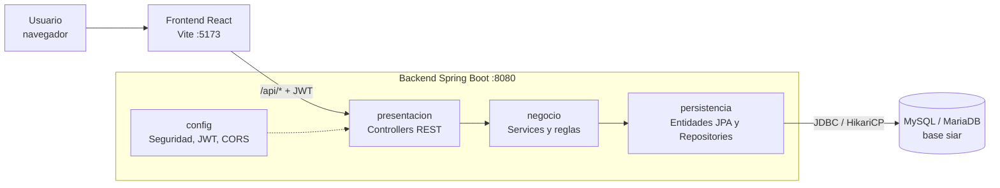
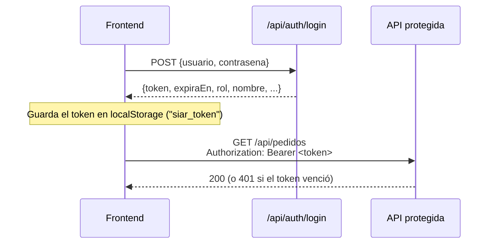
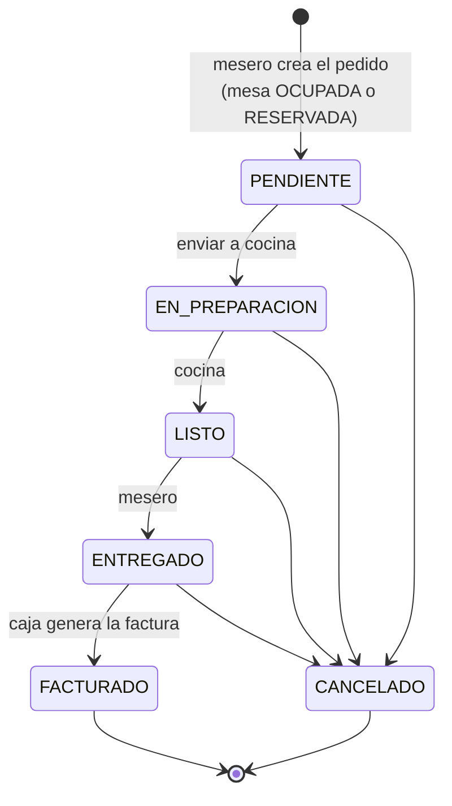

# Manual técnico — SIAR

**Sistema Integral de Administración para Restaurantes**
Proyecto de Ingeniería de Software II — Institución Universitaria Antonio José Camacho

| | |
|---|---|
| Versión del documento | 1.0 |
| Fecha | Noviembre de 2026 |
| Rama de referencia | `develop` (incluye la vista de login del PR #22) |

---

## Contenido

1. [Propósito y alcance](#1-propósito-y-alcance)
2. [Arquitectura](#2-arquitectura)
3. [Tecnologías y versiones](#3-tecnologías-y-versiones)
4. [Estructura del repositorio](#4-estructura-del-repositorio)
5. [Requisitos del entorno](#5-requisitos-del-entorno)
6. [Instalación y puesta en marcha](#6-instalación-y-puesta-en-marcha)
7. [Variables de entorno](#7-variables-de-entorno)
8. [Base de datos](#8-base-de-datos)
9. [Seguridad](#9-seguridad)
10. [API REST](#10-api-rest)
11. [Reglas de negocio principales](#11-reglas-de-negocio-principales)
12. [Frontend](#12-frontend)
13. [Pruebas](#13-pruebas)
14. [Flujo de trabajo con Git](#14-flujo-de-trabajo-con-git)
15. [Solución de problemas](#15-solución-de-problemas)
16. [Limitaciones conocidas y pendientes](#16-limitaciones-conocidas-y-pendientes)

---

## 1. Propósito y alcance

Este manual describe cómo está construido SIAR y cómo instalarlo, configurarlo, ejecutarlo, probarlo y extenderlo. Está dirigido a desarrolladores que se integren al proyecto y a quienes evalúen su construcción.

SIAR centraliza la operación de un restaurante: usuarios y roles, menú, mesas y reservas, pedidos, facturación y, en una fase posterior, reportes. El módulo de inventario quedó fuera del alcance de esta fase.

El estado funcional de cada historia de usuario está en [`MVP.md`](../../MVP.md). La guía rápida de instalación está en el [`README.md`](../../README.md).

---

## 2. Arquitectura

SIAR es un **monolito organizado en capas**, con un frontend separado que consume una API REST.



| Capa | Paquete | Responsabilidad |
|---|---|---|
| Presentación | `com.siar.presentacion` | Recibe las peticiones HTTP, valida los cuerpos (`@Valid`) y responde JSON. No contiene reglas de negocio. |
| Negocio | `com.siar.negocio` | Reglas, validaciones, cálculos y transacciones (`@Transactional`). Devuelve DTOs. |
| Persistencia | `com.siar.persistencia` | Entidades JPA mapeadas a las tablas y repositorios de Spring Data. |
| Configuración | `com.siar.config` | Spring Security, JWT, CORS y el usuario administrador inicial. |

**Flujo de una petición:** el frontend llama a `/api/...` con el header `Authorization: Bearer <token>`. Spring Security valida el token y el rol, el controlador delega en el servicio, el servicio aplica las reglas y usa los repositorios, y la respuesta vuelve como JSON.

### Patrones de diseño aplicados

| Patrón | Dónde |
|---|---|
| Repository | Un repositorio por entidad (`ProductoRepository`, `PedidoRepository`, `FacturaRepository`…). |
| MVC | Controladores REST en el backend; vistas React en el frontend. |
| Singleton | Servicios, repositorios y configuración son beans únicos de Spring; el pool de conexiones lo gestiona HikariCP. |
| DTO | Autenticación, pedidos y facturación devuelven DTOs (`PedidoDto`, `FacturaDto`, `LoginResponse`). Menú y mesas aún devuelven entidades. |

---

## 3. Tecnologías y versiones

### Backend

| Tecnología | Versión | Uso |
|---|---|---|
| Java | 21 | Lenguaje |
| Spring Boot | 4.1.1 | Framework base |
| Spring Web MVC | (Boot 4.1.1) | API REST |
| Spring Data JPA / Hibernate | (Boot 4.1.1) | Persistencia |
| Spring Security + OAuth2 Resource Server | (Boot 4.1.1) | Autenticación JWT (HS256, Nimbus) y autorización por rol |
| Bean Validation | (Boot 4.1.1) | Validación de peticiones |
| MySQL Connector/J | (Boot 4.1.1) | Driver JDBC |
| HikariCP | (Boot 4.1.1) | Pool de conexiones |
| Maven Wrapper | incluido (`mvnw`) | Compilación |

### Frontend

| Tecnología | Versión | Uso |
|---|---|---|
| React | 19 | Interfaz |
| React Router DOM | 7 | Navegación y rutas protegidas |
| Bootstrap | 5.3 | Base de estilos |
| Vite | 6 | Servidor de desarrollo y build |

### Base de datos y herramientas

| Herramienta | Uso |
|---|---|
| MySQL o MariaDB (XAMPP / WampServer) | Base de datos `siar` (probado con MariaDB 10.4) |
| phpMyAdmin o MySQL Workbench | Administración de la base |
| Postman / Newman | Pruebas de la API |
| Git y GitHub | Control de versiones |

---

## 4. Estructura del repositorio

```text
Restaurante_Ing_software_-/
├── backend/siar-backend/
│   ├── pom.xml
│   ├── mvnw, mvnw.cmd
│   └── src/
│       ├── main/java/com/siar/
│       │   ├── SiarBackendApplication.java
│       │   ├── config/seguridad/        SecurityConfig, AdminInicial, RespuestaErrorSeguridad
│       │   ├── presentacion/            Controllers por módulo + ManejadorErrores
│       │   │   ├── seguridad/  menu/  mesas/  pedidos/  facturacion/
│       │   ├── negocio/                 Services y DTOs por módulo
│       │   │   ├── seguridad/  menu/  mesas/  pedidos/  facturacion/
│       │   └── persistencia/            Entidades y Repositories por módulo
│       │       ├── usuario/  menu/  mesas/  pedidos/  facturacion/
│       ├── main/resources/application.properties
│       └── test/java/com/siar/          Pruebas unitarias
├── frontend/SIAR_frontend_categorias/
│   ├── package.json, vite.config.js, index.html
│   └── src/
│       ├── main.jsx, App.jsx            Punto de entrada y rutas
│       ├── config/roles.js              Secciones permitidas por rol
│       ├── routes/                      RutaProtegida, RutaPublica
│       ├── layouts/AdminLayout.jsx      Layout del panel
│       ├── services/api.js              Cliente HTTP común
│       ├── components/ui/               SiarIcon, UsuarioActual
│       ├── features/                    Vistas por módulo
│       │   ├── auth/  menu/  mesas/  pedidos/
│       └── styles/                      tokens.css, global.css, components.css y estilos por vista
├── docs/
│   ├── configuracion/                   Scripts SQL y guía de conexión
│   ├── diseno/                          Requerimientos, casos de uso, UML, MER, arquitectura
│   ├── postman/                         SIAR_COLLECTION y SIAR_ENVIRONMENT
│   └── manuales/                        Este manual
├── scripts/run-backend.ps1              Carga el .env y arranca el backend
├── .env.example                         Plantilla de variables de entorno
├── MVP.md                               Estado del MVP frente a los requisitos
└── README.md
```

---

## 5. Requisitos del entorno

| Requisito | Detalle |
|---|---|
| JDK 21 | Para compilar y ejecutar el backend. `JAVA_HOME` debe apuntar al JDK. |
| Node.js 20 o superior y npm | Para el frontend (probado con Node 22). |
| MySQL 8 o MariaDB 10.4+ | XAMPP o WampServer en desarrollo. |
| Git | Control de versiones. |
| Postman (opcional) | Para ejecutar la colección de pruebas. |
| Puertos libres | `3306` (MySQL), `8080` (backend), `5173` (frontend). |

No es necesario instalar Maven: el proyecto incluye el wrapper `mvnw`.

---

## 6. Instalación y puesta en marcha

### 6.1 Clonar

```bash
git clone https://github.com/ejosephfernandez/Restaurante_Ing_software_-.git
cd Restaurante_Ing_software_-
git checkout develop
```

### 6.2 Base de datos

Con MySQL o MariaDB en ejecución, como `root`:

```sql
CREATE DATABASE IF NOT EXISTS siar CHARACTER SET utf8mb4 COLLATE utf8mb4_unicode_ci;
CREATE USER IF NOT EXISTS 'siar_app'@'localhost' IDENTIFIED BY '1234';
GRANT ALL PRIVILEGES ON siar.* TO 'siar_app'@'localhost';
FLUSH PRIVILEGES;
```

Luego ejecutar los scripts de `docs/configuracion/` **en este orden**:

| Orden | Script | Qué hace |
|---|---|---|
| 1 | `Script DDL SIAR.sql` | Crea las 13 tablas con llaves, índices y restricciones `CHECK`. |
| 2 | `Script DML roles SIAR.sql` | Inserta los roles ADMINISTRADOR, CAJERO, MESERO y COCINERO. |
| 3 | *(arrancar el backend una vez, ver 6.4)* | Crea el usuario administrador inicial. |
| 4 | `Script DML usuarios prueba SIAR.sql` | Opcional, solo desarrollo: crea `mesero`, `cajero` y `cocinero` con la misma contraseña del admin. |

> `siar_app` / `1234` son credenciales de desarrollo. En otro entorno se deben usar credenciales propias.

### 6.3 Variables de entorno

```bash
cp .env.example .env
```

Completar el `.env` (ver [sección 7](#7-variables-de-entorno)). Como mínimo: `DB_PASSWORD`, `JWT_SECRET` y `SIAR_ADMIN_PASSWORD`. El `.env` **no se sube a Git** (está en `.gitignore`).

### 6.4 Backend

Spring Boot no lee el `.env` por sí solo. En Windows PowerShell, desde la raíz:

```powershell
.\scripts\run-backend.ps1
```

El script carga el `.env` y ejecuta `mvnw spring-boot:run`. La API queda en `http://localhost:8080`. Al arrancar por primera vez, el log muestra:

```text
Usuario administrador inicial 'admin' creado
```

En Linux o macOS se pueden exportar las variables y ejecutar `./mvnw spring-boot:run` desde `backend/siar-backend`.

**Otros comandos útiles** (desde `backend/siar-backend`):

| Comando | Uso |
|---|---|
| `./mvnw test` | Ejecutar las pruebas unitarias |
| `./mvnw -DskipTests package` | Generar el `.jar` en `target/` |
| `java -jar target/siar-backend-0.0.1-SNAPSHOT.jar` | Ejecutar el `.jar` (con las variables de entorno cargadas) |

Para usar otro puerto: variable de entorno `SERVER_PORT` (por ejemplo `SERVER_PORT=8085`).

### 6.5 Frontend

```bash
cd frontend/SIAR_frontend_categorias
npm ci
npm run dev
```

La aplicación queda en `http://localhost:5173`. Vite redirige las peticiones `/api` a `http://localhost:8080` (ver `vite.config.js`), así que no hace falta configurar CORS en desarrollo.

| Comando | Uso |
|---|---|
| `npm run dev` | Servidor de desarrollo |
| `npm run build` | Build de producción en `dist/` |
| `npm run preview` | Servir el build localmente |

### 6.6 Verificar

1. Abrir `http://localhost:5173` → debe aparecer la pantalla de login.
2. Ingresar con `admin` y la contraseña de `SIAR_ADMIN_PASSWORD`.
3. Debe abrir el panel en **Pedidos**, con el menú completo del administrador.

---

## 7. Variables de entorno

| Variable | Obligatoria | Valor por defecto | Descripción |
|---|---|---|---|
| `DB_URL` | Sí | `jdbc:mysql://localhost:3306/siar` | URL JDBC de la base. |
| `DB_USERNAME` | Sí | `siar_app` | Usuario de la base. |
| `DB_PASSWORD` | Sí | — | Contraseña de la base. |
| `JWT_SECRET` | **Sí** | — | Clave para firmar los tokens (HS256), **mínimo 32 caracteres**. Sin ella el backend no arranca. |
| `JWT_EXPIRATION_MINUTES` | No | `480` | Vigencia del token (8 horas). |
| `CORS_ALLOWED_ORIGIN` | No | `http://localhost:5173` | Origen permitido para el frontend. |
| `SIAR_ADMIN_USER` | No | `admin` | Usuario del administrador inicial. |
| `SIAR_ADMIN_EMAIL` | No | `admin@siar.local` | Correo del administrador inicial. |
| `SIAR_ADMIN_PASSWORD` | Para el primer arranque | — | Contraseña del administrador inicial (ver 9.4). |
| `SIAR_TASA_IMPUESTO` | No | `0.08` | Tasa de impuesto de las facturas (8 % impuesto al consumo). |
| `SIAR_DESCUENTO_MAXIMO` | No | `20` | Porcentaje máximo de descuento que un cajero aplica sin autorización. |
| `SIAR_NEGOCIO_NOMBRE` | No | `Restaurante SIAR` | Datos del negocio impresos en el comprobante. |
| `SIAR_NEGOCIO_NIT` | No | `900000000-0` | |
| `SIAR_NEGOCIO_DIRECCION` | No | `Cali, Colombia` | |
| `SIAR_NEGOCIO_TELEFONO` | No | — | |
| `REDIS_HOST`, `REDIS_PORT` | No | — | Reservadas; Redis aún no está integrado. |

---

## 8. Base de datos

Motor relacional MySQL/MariaDB, base `siar`, codificación `utf8mb4`. El esquema se crea con `Script DDL SIAR.sql`; Hibernate **no** modifica el esquema (`spring.jpa.hibernate.ddl-auto=none`).

### 8.1 Tablas

| Módulo | Tabla | Descripción |
|---|---|---|
| Usuarios | `ROL` | Roles del sistema. |
| | `PERMISO` | Permisos (catálogo). |
| | `ROL_PERMISO` | Permisos de cada rol (N:M). |
| | `USUARIO` | Usuarios; cada uno tiene **un** rol. Contraseña con hash BCrypt. |
| Menú | `CATEGORIA` | Categorías del menú (desactivación lógica). |
| | `PRODUCTO` | Productos con precio, disponibilidad y estado activo. |
| Mesas | `MESA` | Mesas con número único, capacidad y estado. |
| | `RESERVA` | Reservas de una mesa. |
| Pedidos | `PEDIDO` | Pedido de una mesa, con mesero, estado y total. |
| | `DETALLE_PEDIDO` | Productos del pedido con cantidad, precio del momento y observación. |
| Facturación | `FACTURA` | Una factura por pedido, con número consecutivo único. |
| | `PAGO` | Pagos de la factura (varios para pago mixto). |
| | `COMPROBANTE` | Histórico de comprobantes emitidos. |

El modelo entidad-relación está en `docs/diseno/MER.jpeg`.

### 8.2 Valores permitidos (restricciones `CHECK`)

| Campo | Valores |
|---|---|
| `MESA.estado` | `DISPONIBLE`, `OCUPADA`, `RESERVADA`, `INACTIVA` |
| `PEDIDO.estado` | `PENDIENTE`, `EN_PREPARACION`, `LISTO`, `ENTREGADO`, `FACTURADO`, `CANCELADO` |
| `FACTURA.estado` | `EMITIDA`, `PAGADA`, `ANULADA` |
| `PAGO.metodo` | `EFECTIVO`, `TARJETA`, `TRANSFERENCIA` |
| `COMPROBANTE.formato` | `PDF`, `IMPRESO`, `ELECTRONICO` |
| `RESERVA.estado` | `PENDIENTE`, `CONFIRMADA`, `CANCELADA` (sin `CHECK`, lo maneja el servicio) |

### 8.3 Reglas de integridad relevantes

- Las llaves foráneas usan `ON DELETE RESTRICT`: no se puede borrar una mesa con pedidos, ni un producto que esté en un pedido.
- Menú, mesas y usuarios usan **borrado lógico** (campos `activo` / `activa`) para conservar el historial.
- `FACTURA.id_pedido` es único: un pedido tiene como máximo una factura.

---

## 9. Seguridad

### 9.1 Autenticación con JWT



- Contraseñas almacenadas con **BCrypt**.
- Tokens firmados con **HS256** usando `JWT_SECRET`. Incluyen `id`, `nombre`, `rol` y `permisos`.
- Sesión **sin estado** (stateless): el servidor no guarda sesiones.
- `POST /api/auth/login` es la única ruta pública; todo lo demás exige token.
- El login acepta el nombre de usuario **o** el correo. Un usuario con `activo = false` no puede iniciar sesión.

### 9.2 Autorización por rol (backend)

Definida en `config/seguridad/SecurityConfig.java`. Sin token → **401**; rol sin permiso → **403**.

| Operación | Roles |
|---|---|
| Consultar (GET) menú, mesas, reservas y pedidos | Cualquier usuario autenticado |
| Crear, editar o desactivar categorías y productos | ADMINISTRADOR |
| Cambiar disponibilidad de un producto | ADMINISTRADOR, COCINERO |
| Crear, editar o eliminar mesas | ADMINISTRADOR |
| Cambiar el estado de una mesa | ADMINISTRADOR, MESERO |
| Crear reservas | ADMINISTRADOR, MESERO, CAJERO |
| Confirmar, cancelar o editar reservas | ADMINISTRADOR, MESERO |
| Eliminar reservas | ADMINISTRADOR |
| Crear pedidos, manejar sus productos, enviar a cocina, entregar, cancelar | ADMINISTRADOR, MESERO |
| Marcar un pedido como LISTO | ADMINISTRADOR, COCINERO |
| Todo `/api/facturas/**` | ADMINISTRADOR, CAJERO |

Todo endpoint nuevo queda protegido por token automáticamente. Para restringirlo a ciertos roles se agrega su regla en `SecurityConfig`.

### 9.3 Sesión en el frontend

- `features/auth/context/AuthContext.jsx` guarda la sesión (token, nombre, rol, vencimiento) y expone `login`, `logout` y `rol`.
- La sesión se conserva al recargar la página y se cierra automáticamente cuando vence el token.
- Si la API responde **401** (token vencido o inválido), `services/api.js` cierra la sesión y el usuario vuelve al login con el aviso "Tu sesión expiró".
- El login **no envía** el token guardado: un token viejo haría que Spring Security rechazara la propia petición de login.

### 9.4 Usuario administrador inicial

La clase `config/seguridad/AdminInicial.java` crea el primer ADMINISTRADOR al arrancar el backend, para no tener que insertar hashes BCrypt a mano. Solo actúa si:

1. La variable `SIAR_ADMIN_PASSWORD` tiene valor.
2. La tabla `USUARIO` está vacía.

En los arranques siguientes no hace nada. Cambiar `SIAR_ADMIN_PASSWORD` después no cambia la contraseña del admin existente.

### 9.5 Buenas prácticas

- No subir el `.env` ni contraseñas reales al repositorio.
- Usar un `JWT_SECRET` largo y aleatorio en cada entorno.
- Las credenciales de los scripts y del `.env.example` son solo para desarrollo.

---

## 10. API REST

Base: `http://localhost:8080/api`. Todas las respuestas son JSON. Salvo el login, todas las rutas requieren el header `Authorization: Bearer <token>`.

### 10.1 Formato de errores

Todos los módulos responden los errores con el mismo formato (`presentacion/ManejadorErrores.java` y `config/seguridad/RespuestaErrorSeguridad.java`):

```json
{ "estado": 409, "error": "Conflict", "mensaje": "Solo se factura un pedido ENTREGADO (estado actual: LISTO)" }
```

| Código | Cuándo |
|---|---|
| 400 | Datos inválidos (validaciones, JSON mal formado, parámetro con tipo incorrecto). |
| 401 | Sin token, token inválido o vencido, o credenciales incorrectas. |
| 403 | El rol no tiene permiso para la operación. |
| 404 | El recurso no existe. |
| 409 | El estado actual no permite la operación (por ejemplo, facturar un pedido no entregado). |

### 10.2 Autenticación — `/api/auth`

| Método | Ruta | Descripción |
|---|---|---|
| POST | `/api/auth/login` | Inicia sesión. Cuerpo: `{ "usuario": "admin", "contrasena": "..." }`. Devuelve `token`, `tipo`, `expiraEn`, `idUsuario`, `nombre`, `usuario`, `rol`, `permisos`. |
| GET | `/api/auth/me` | Datos del usuario dueño del token. |

### 10.3 Categorías — `/api/categorias`

| Método | Ruta | Descripción |
|---|---|---|
| GET | `/api/categorias` | Todas las categorías. |
| GET | `/api/categorias/activas` | Solo las activas. |
| GET | `/api/categorias/{id}` | Una categoría. |
| POST | `/api/categorias` | Crear: `{ "nombre": "Bebidas" }`. |
| PUT | `/api/categorias/{id}` | Actualizar nombre y estado. |
| DELETE | `/api/categorias/{id}` | Desactivar (borrado lógico). |

### 10.4 Productos — `/api/productos`

| Método | Ruta | Descripción |
|---|---|---|
| GET | `/api/productos` | Todos los productos con su categoría. |
| GET | `/api/productos/activos` | Solo activos. |
| GET | `/api/productos/disponibles` | Activos y disponibles. |
| GET | `/api/productos/categoria/{idCategoria}` | Por categoría. |
| GET | `/api/productos/{id}` | Un producto. |
| POST | `/api/productos` | Crear: `{ "nombre", "descripcion", "precio", "imagen", "categoria": { "idCategoria" } }`. |
| PUT | `/api/productos/{id}` | Actualizar. |
| PATCH | `/api/productos/{id}/disponibilidad?disponible=true` | Marcar disponible o agotado. |
| DELETE | `/api/productos/{id}` | Desactivar (borrado lógico). |

### 10.5 Mesas — `/api/mesas`

| Método | Ruta | Descripción |
|---|---|---|
| GET | `/api/mesas` | Todas las mesas. |
| GET | `/api/mesas/{id}` | Una mesa. |
| POST | `/api/mesas` | Crear: `{ "numero", "capacidad", "ubicacion" }`. Inicia DISPONIBLE. |
| PUT | `/api/mesas/{id}` | Actualizar número, capacidad y ubicación. |
| PUT | `/api/mesas/{id}/estado?nuevoEstado=OCUPADA` | Cambiar el estado. |
| GET | `/api/mesas/{id}/disponible` | `true` si está DISPONIBLE. |
| GET | `/api/mesas/{id}/reservas` | Reservas de la mesa. |

### 10.6 Reservas — `/api/reservas`

| Método | Ruta | Descripción |
|---|---|---|
| GET | `/api/reservas` | Todas las reservas. |
| GET | `/api/reservas/{id}` | Una reserva. |
| POST | `/api/reservas` | Crear: `{ "mesa": { "idMesa" }, "fechaHora", "nombreCliente", "telefono", "numPersonas" }`. |
| PUT | `/api/reservas/{id}` | Actualizar datos del cliente. |
| PUT | `/api/reservas/{id}/confirmar` | Pasa a CONFIRMADA. |
| PUT | `/api/reservas/{id}/cancelar` | Pasa a CANCELADA. |
| DELETE | `/api/reservas/{id}` | Eliminar. |

> Ver la [sección 16](#16-limitaciones-conocidas-y-pendientes): este módulo tiene correcciones pendientes.

### 10.7 Pedidos — `/api/pedidos`

| Método | Ruta | Descripción |
|---|---|---|
| GET | `/api/pedidos?idMesa=&idMesero=&estado=` | Consultar con filtros opcionales. |
| GET | `/api/pedidos/{id}` | Un pedido con su detalle. |
| POST | `/api/pedidos` | Crear: `{ "idMesa": 1 }`. El mesero sale del token. |
| POST | `/api/pedidos/{id}/detalles` | Agregar producto: `{ "idProducto", "cantidad", "observacion" }`. |
| PUT | `/api/pedidos/{id}/detalles/{idDetalle}` | Modificar cantidad u observación. |
| DELETE | `/api/pedidos/{id}/detalles/{idDetalle}` | Quitar un producto. |
| PATCH | `/api/pedidos/{id}/enviar-cocina` | PENDIENTE → EN_PREPARACION. |
| PATCH | `/api/pedidos/{id}/listo` | EN_PREPARACION → LISTO. |
| PATCH | `/api/pedidos/{id}/entregado` | LISTO → ENTREGADO. |
| PATCH | `/api/pedidos/{id}/cancelar` | Cancelar (si no está FACTURADO). |

### 10.8 Facturación — `/api/facturas`

| Método | Ruta | Descripción |
|---|---|---|
| POST | `/api/facturas/previsualizar` | Calcula el desglose sin guardar: `{ "idPedido", "descuento": { "tipo": "PORCENTAJE", "valor": 10 } }`. |
| POST | `/api/facturas` | Genera la factura (mismo cuerpo; descuento opcional, tipo `PORCENTAJE` o `MONTO`). |
| GET | `/api/facturas?estado=` | Consultar facturas. |
| GET | `/api/facturas/{id}` | Una factura con detalle, desglose y pagos. |
| GET | `/api/facturas/pedido/{idPedido}` | Factura de un pedido. |
| POST | `/api/facturas/{id}/pagos` | Registrar pagos: `{ "pagos": [ { "metodo": "TARJETA", "monto": 30000 }, { "metodo": "EFECTIVO", "monto": 20000 } ] }`. |
| POST | `/api/facturas/{id}/comprobantes` | Emitir comprobante: `{ "formato": "PDF" }`. |
| GET | `/api/facturas/{id}/comprobantes` | Histórico de comprobantes. |

---

## 11. Reglas de negocio principales

### 11.1 Ciclo de vida del pedido



- Solo se agregan productos **activos y disponibles**. El precio se guarda al momento de agregarlos, así que un cambio posterior en el menú no altera pedidos ya tomados.
- Los productos se modifican o quitan solo en **PENDIENTE**; se pueden agregar en PENDIENTE o EN_PREPARACION.
- No se envía a cocina un pedido vacío y no se saltan estados.

### 11.2 Cálculo de la factura

```text
subtotal      = Σ (cantidad × precio unitario)
descuento     = porcentaje del subtotal o monto fijo (no puede superar el subtotal)
base gravable = subtotal − descuento
impuesto      = base gravable × SIAR_TASA_IMPUESTO
total         = base gravable + impuesto
```

- Todos los valores se redondean a 2 decimales.
- Un CAJERO aplica descuentos hasta `SIAR_DESCUENTO_MAXIMO` %; por encima solo un ADMINISTRADOR (si no, 403).
- La factura recibe un número consecutivo y el pedido pasa a FACTURADO.

### 11.3 Pagos

- La suma de los pagos debe cubrir el total.
- Tarjeta y transferencia no pueden superar el total; el efectivo sí, y la diferencia se devuelve como **cambio**.
- En la tabla `PAGO` el efectivo se guarda por lo efectivamente aplicado, así que la suma de `PAGO.monto` siempre coincide con `FACTURA.total`.
- Al registrar el pago la factura pasa a PAGADA, y solo entonces se puede emitir el comprobante.

---

## 12. Frontend

### 12.1 Organización

| Carpeta | Contenido |
|---|---|
| `features/<modulo>/pages` | Vistas (una por pantalla). |
| `features/<modulo>/services` | Llamadas a la API del módulo. |
| `features/<modulo>/components` | Componentes propios del módulo. |
| `services/api.js` | Cliente HTTP común: agrega el token, maneja errores y el 401. |
| `config/roles.js` | Secciones que ve cada rol y su pantalla de inicio. |
| `routes/` | `RutaProtegida` (exige sesión y rol) y `RutaPublica` (login). |
| `layouts/AdminLayout.jsx` | Barra lateral con el menú filtrado por rol y el contenido. |
| `components/ui/` | Componentes compartidos (`SiarIcon`, `UsuarioActual`). |
| `styles/` | `tokens.css` (colores, tipografía, espacios), `components.css` (clases reutilizables) y estilos por vista. |

### 12.2 Rutas y roles

| Ruta | Vista | Roles |
|---|---|---|
| `/login` | Inicio de sesión | Pública (con sesión redirige al inicio) |
| `/pedidos` | Pedidos | Todos (pantalla de inicio) |
| `/productos` | Productos | ADMINISTRADOR, COCINERO |
| `/categorias` | Categorías | ADMINISTRADOR |
| `/mesas` | Mesas | ADMINISTRADOR, MESERO |
| `/mesas/reservas` | Reservas | ADMINISTRADOR, MESERO, CAJERO |

Si un usuario abre por URL una ruta que su rol no permite, se le redirige a su pantalla de inicio.

### 12.3 Cómo agregar una vista nueva

1. Crear la página en `src/features/<modulo>/pages/` y su servicio en `src/features/<modulo>/services/`, usando `apiRequest` de `services/api.js` (agrega el token automáticamente).
2. Registrar la sección y sus roles en `src/config/roles.js` (`SECCIONES`).
3. Agregar la ruta en `src/App.jsx`, envuelta en `<RutaProtegida seccion="...">`.
4. Agregar el enlace en `src/layouts/AdminLayout.jsx`, condicionado con `puedeAcceder(rol, "...")`.
5. Usar las variables de `tokens.css` y las clases de `components.css` para mantener el estilo, y `<UsuarioActual />` en la barra superior.

---

## 13. Pruebas

### 13.1 Pruebas unitarias del backend

No requieren base de datos (usan Mockito y MockMvc). Desde `backend/siar-backend`:

```bash
./mvnw test
```

| Clase | Pruebas | Qué cubre |
|---|---|---|
| `SeguridadJwtTests` | 8 | Login correcto e incorrecto, usuario inactivo, token ausente o inválido, 403 por rol. |
| `PedidoServiceTests` | 12 | Creación, productos, modificación, flujo de estados y cancelación. |
| `FacturaServiceTests` | 11 | Generación, límite de descuento, pagos mixtos, cambio y comprobante. |
| `CalculadoraFacturaTests` | 8 | Cálculo de descuento, impuesto, total y redondeo. |

> `SiarBackendApplicationTests` carga el contexto completo y necesita la base de datos y las variables de entorno.

### 13.2 Colección de Postman

En `docs/postman/`:

- `SIAR_COLLECTION.postman_collection.json`
- `SIAR_ENVIRONMENT.postman_environment.json`

Importar ambos, seleccionar el environment **SIAR ENVIRONMENT** y ejecutar la colección completa en orden (carpetas 1 a 7: autenticación, permisos, mesas, productos, pedidos, facturación y reservas). Requiere los usuarios de `Script DML usuarios prueba SIAR.sql`.

Desde la consola, con Newman:

```bash
npx newman run docs/postman/SIAR_COLLECTION.postman_collection.json -e docs/postman/SIAR_ENVIRONMENT.postman_environment.json
```

### 13.3 Matriz de pruebas

Cada caso indica la historia de usuario que valida, el tipo de prueba, el resultado esperado, el resultado obtenido y dónde está la evidencia.

**Tipos de prueba y evidencia**

| Sigla | Tipo | Dónde |
|---|---|---|
| U | Unitaria | Clases de `backend/siar-backend/src/test` (`./mvnw test`) |
| P*n* | Integración de API | Carpeta *n* de `SIAR_COLLECTION` (Postman / Newman) contra MySQL real |
| F | Funcional en navegador | Recorrido de la interfaz en Microsoft Edge contra backend y MySQL reales |
| M | Manual contra la API | Peticiones directas a la API con usuarios de prueba |

**Resultados:** ✅ Pasa · ❌ Falla · ⏳ No implementado

**Entorno de ejecución:** Windows 11, JDK 21, MariaDB 10.4 (XAMPP), Node 22, Microsoft Edge. Última ejecución: noviembre de 2026.

#### Usuarios y seguridad

| ID | HU | Caso de prueba | Tipo | Resultado esperado | Resultado | Evidencia |
|---|---|---|---|---|---|---|
| CP-01 | HU06 | Iniciar sesión con usuario y contraseña correctos | U, P1, F | 200 con token, rol y nombre | ✅ | `SeguridadJwtTests`, P1 |
| CP-02 | HU06 | Iniciar sesión con el correo | P1 | 200 con token | ✅ | P1 |
| CP-03 | HU06 | Contraseña incorrecta | U, P1, F | 401 con mensaje genérico, sin decir qué dato falló | ✅ | `SeguridadJwtTests`, P1 |
| CP-04 | HU06 | Usuario inexistente | U, P1 | 401 con el mismo mensaje genérico | ✅ | `SeguridadJwtTests`, P1 |
| CP-05 | HU03, HU06 | Usuario desactivado intenta iniciar sesión | U, F | 401 "usuario inactivo" | ✅ | `SeguridadJwtTests`, F |
| CP-06 | HU06 | Usuario y contraseña vacíos | P1, F | 400 / mensaje en la vista | ✅ | P1, F |
| CP-07 | RNF | Petición sin token | U, P1 | 401 | ✅ | `SeguridadJwtTests`, P1 |
| CP-08 | RNF | Token alterado o con firma inválida | U, P1 | 401 | ✅ | `SeguridadJwtTests`, P1 |
| CP-09 | HU04 | Rol sin permiso (mesero crea una categoría) | U, P2 | 403 | ✅ | `SeguridadJwtTests`, P2 |
| CP-10 | HU06 | Redirección y menú según el rol (4 roles) | F | Cada rol entra a Pedidos y ve solo sus secciones | ✅ | F |
| CP-11 | HU06 | Abrir por URL una ruta no permitida para el rol | F | Redirige a la pantalla de inicio del rol | ✅ | F |
| CP-12 | HU06 | Token vencido o inválido durante el uso | F | Vuelve al login con el aviso "Tu sesión expiró" | ✅ | F |
| CP-13 | HU06 | Cerrar sesión | F | Limpia la sesión; no se puede volver sin login | ✅ | F |
| CP-14 | HU01–HU03 | Registrar, editar y desactivar usuarios | — | CRUD de usuarios | ⏳ | Sin endpoints ni vista |
| CP-15 | HU07 | Recuperar contraseña | — | Envío de código por correo | ⏳ | No implementado |

#### Menú

| ID | HU | Caso de prueba | Tipo | Resultado esperado | Resultado | Evidencia |
|---|---|---|---|---|---|---|
| CP-16 | HU11 | Administrador crea una categoría | P2 | 201 | ✅ | P2 |
| CP-17 | HU11 | Desactivar una categoría | P2 | 204, borrado lógico | ✅ | P2 |
| CP-18 | HU08 | Crear un producto con categoría activa | P4 | 201 | ✅ | P4 |
| CP-19 | HU09 | Actualizar un producto | P4 | 200 con los datos nuevos | ✅ | P4 |
| CP-20 | HU12 | Cambiar disponibilidad (administrador o cocinero); el mesero no puede | P2, P4 | 200; mesero 403 | ✅ | P2, P4 |
| CP-21 | HU12 | Agregar a un pedido un producto agotado | U | 409 "no está disponible" | ✅ | `PedidoServiceTests` |
| CP-22 | HU10 | Bloquear la baja de un producto que está en un pedido activo | — | Rechazar con advertencia | ⏳ | No implementado |

#### Mesas y reservas

| ID | HU | Caso de prueba | Tipo | Resultado esperado | Resultado | Evidencia |
|---|---|---|---|---|---|---|
| CP-23 | HU13 | Crear una mesa | P2, P3 | 201 con estado DISPONIBLE | ✅ | P2, P3 |
| CP-24 | HU14 | Editar una mesa (administrador); el mesero no puede | P2, P3 | 200; mesero 403 | ✅ | P2, P3 |
| CP-25 | HU15 | Consultar mesas y su disponibilidad | P3 | 200 con el estado de cada mesa | ✅ | P3 |
| CP-26 | HU17 | El mesero cambia el estado de una mesa | P2, P3 | 200 | ✅ | P2, P3 |
| CP-27 | HU17 | Enviar un estado de mesa inválido | M | 400 | ❌ | Acepta cualquier texto |
| CP-28 | HU16 | Crear una reserva por la API (`POST /api/reservas`) | P7 | 201 | ✅ | P7 |
| CP-29 | HU16 | Crear una reserva desde la vista | M | Reserva creada | ❌ | La vista usa `POST /api/mesas/{id}/reservas` → 405 |
| CP-30 | HU16 | La reserva guarda la fecha y hora solicitadas | M | Fecha solicitada | ❌ | Guarda la fecha de creación (`@CreationTimestamp`) |
| CP-31 | HU16 | Reservar la misma mesa en el mismo horario | M | 409 | ❌ | Se crean ambas reservas |
| CP-32 | HU16 | Al confirmar, la mesa pasa a RESERVADA | M | Mesa RESERVADA | ❌ | La mesa sigue DISPONIBLE |
| CP-33 | HU16 | Permisos de reservas (cocinero crea, cajero confirma, mesero elimina) | P7 | 403 en los tres; administrador elimina 204 | ✅ | P7 |
| CP-34 | HU16 | Consultar una reserva inexistente | M | 404 | ❌ | Responde 500 |

#### Pedidos

| ID | HU | Caso de prueba | Tipo | Resultado esperado | Resultado | Evidencia |
|---|---|---|---|---|---|---|
| CP-35 | HU18 | Crear un pedido en una mesa OCUPADA | U, P5 | 201, estado PENDIENTE, mesero y fecha registrados | ✅ | `PedidoServiceTests`, P5 |
| CP-36 | HU18 | Crear un pedido en una mesa DISPONIBLE | U, P5 | 409 | ✅ | `PedidoServiceTests`, P5 |
| CP-37 | HU19 | Agregar productos; repetir el mismo suma la cantidad | U, P5 | Total recalculado | ✅ | `PedidoServiceTests`, P5 |
| CP-38 | HU19 | Agregar un producto con cantidad 0 | P5 | 400 | ✅ | P5 |
| CP-39 | HU20 | Modificar y quitar productos en PENDIENTE | U, P5 | Total recalculado | ✅ | `PedidoServiceTests`, P5 |
| CP-40 | HU20 | Modificar un pedido ya enviado a cocina | U, P5 | 409 | ✅ | `PedidoServiceTests`, P5 |
| CP-41 | HU22 | Enviar a cocina; enviar un pedido vacío | U, P5 | EN_PREPARACION con hora de envío; vacío 409 | ✅ | `PedidoServiceTests`, P5 |
| CP-42 | HU23 | Marcar LISTO (solo cocina) y ENTREGADO; no saltar estados | U, P5 | Transiciones válidas; mesero no marca LISTO (403) | ✅ | `PedidoServiceTests`, P5 |
| CP-43 | HU23 | Filtrar por mesa y estado; estado inválido | P5 | Lista filtrada; estado inválido 400 | ✅ | P5 |
| CP-44 | HU21 | Cancelar un pedido no facturado; cancelar uno facturado | U, P5, P6 | CANCELADO; facturado 409 | ✅ | `PedidoServiceTests`, P5, P6 |

#### Facturación

| ID | HU | Caso de prueba | Tipo | Resultado esperado | Resultado | Evidencia |
|---|---|---|---|---|---|---|
| CP-45 | HU24 | Generar la factura de un pedido ENTREGADO | U, P6 | 201, número consecutivo, cajero registrado, pedido FACTURADO | ✅ | `FacturaServiceTests`, P6 |
| CP-46 | HU24 | Facturar un pedido no entregado o cancelado | U, P6 | 409 | ✅ | `FacturaServiceTests`, P6 |
| CP-47 | HU24 | Facturar dos veces el mismo pedido | U, P6 | 409 | ✅ | `FacturaServiceTests`, P6 |
| CP-48 | HU24 | El mesero intenta facturar | P6 | 403 | ✅ | P6 |
| CP-49 | HU25 | Impuesto sobre (subtotal − descuento) y redondeo a 2 decimales | U, P6 | Desglose correcto | ✅ | `CalculadoraFacturaTests`, P6 |
| CP-50 | HU26 | Descuento por porcentaje y por monto; mayor al subtotal | U, P6 | Total recalculado; mayor al subtotal 400 | ✅ | `CalculadoraFacturaTests`, P6 |
| CP-51 | HU26 | Cajero aplica más del 20 % de descuento; administrador sí puede | U, P6 | Cajero 403; administrador 201 | ✅ | `FacturaServiceTests`, P6 |
| CP-52 | HU27 | Pago mixto (tarjeta + efectivo) con cambio | U, P6 | Factura PAGADA, cambio calculado, suma de pagos = total | ✅ | `FacturaServiceTests`, P6 |
| CP-53 | HU27 | Pago insuficiente, tarjeta mayor al total, pagar dos veces, método inválido | U, P6 | 400, 400, 409 y 400 | ✅ | `FacturaServiceTests`, P6 |
| CP-54 | HU28 | Emitir comprobante de una factura pagada; de una sin pagar | U, P6 | 201 y queda en el histórico; sin pagar 409 | ✅ | `FacturaServiceTests`, P6 |

#### Reportes

| ID | HU | Caso de prueba | Tipo | Resultado esperado | Resultado | Evidencia |
|---|---|---|---|---|---|---|
| CP-55 | HU29, HU30, HU32, HU33 | Reportes de ventas, productos, ocupación e indicadores | — | Reportes con filtros y exportación | ⏳ | No implementado |

#### Resumen

| Módulo | Casos | ✅ Pasa | ❌ Falla | ⏳ No implementado |
|---|---|---|---|---|
| Usuarios y seguridad | 15 | 13 | 0 | 2 |
| Menú | 7 | 6 | 0 | 1 |
| Mesas y reservas | 12 | 6 | 6 | 0 |
| Pedidos | 10 | 10 | 0 | 0 |
| Facturación | 10 | 10 | 0 | 0 |
| Reportes | 1 | 0 | 0 | 1 |
| **Total** | **55** | **45** | **6** | **4** |

Los 6 casos que fallan son del módulo de reservas y de los estados de mesa; su corrección está pendiente (ver [sección 16](#16-limitaciones-conocidas-y-pendientes)).

---

## 14. Flujo de trabajo con Git

| Rama | Uso |
|---|---|
| `main` | Versión estable. |
| `develop` | Integración del equipo. Todo cambio entra por pull request. |
| `feature/<nombre>` | Desarrollo de una funcionalidad, creada desde `develop`. |
| `fix/<nombre>` | Corrección, creada desde `develop`. |

**Pasos:**

1. `git checkout develop && git pull`
2. `git checkout -b feature/<nombre>`
3. Commits pequeños con el formato `tipo(modulo): descripcion` (`feat`, `fix`, `refactor`, `docs`, `test`) y un cuerpo con **What** (qué se hizo) y **Why** (por qué).
4. `git push -u origin feature/<nombre>` y abrir un pull request hacia `develop`, explicando qué cambia y cómo probarlo.

---

## 15. Solución de problemas

| Síntoma | Causa | Solución |
|---|---|---|
| El backend no arranca: "Configure la variable JWT_SECRET con al menos 32 caracteres" | Falta `JWT_SECRET` o es muy corta. | Definirla en el `.env` y arrancar con `run-backend.ps1`. |
| "Port 8080 was already in use" | Otro proceso usa el puerto. | Cerrar ese proceso o usar `SERVER_PORT=8081` (y ajustar `target` en `vite.config.js`). |
| "Access denied for user 'siar_app'" | Usuario o permisos de la base. | Revisar `DB_USERNAME` / `DB_PASSWORD` y ejecutar el `GRANT` de la sección 6.2. |
| "Communications link failure" | MySQL apagado. | Iniciar MySQL. |
| No aparece "Usuario administrador inicial creado" | Falta `SIAR_ADMIN_PASSWORD` o ya hay usuarios. | Ver sección 9.4. |
| `/api/reservas` responde 500 | La base se creó antes de que existiera `RESERVA.estado`. | `ALTER TABLE RESERVA ADD COLUMN estado VARCHAR(20) NOT NULL DEFAULT 'PENDIENTE' AFTER num_personas;` |
| Todas las vistas muestran error 401 | No hay sesión o el token venció. | Iniciar sesión de nuevo. |
| El login responde 401 con la contraseña correcta | Usuario inactivo, o versión vieja del frontend que envía un token guardado. | Activar el usuario; actualizar el frontend o borrar `siar_token` del `localStorage`. |
| El build del frontend falla en Linux pero no en Windows | Un `import` con mayúsculas distintas al nombre real del archivo. | Linux distingue mayúsculas: corregir el nombre en el `import`. |
| MySQL de XAMPP se cierra al iniciar ("Incorrect file format 'db'") | Tablas internas de MySQL dañadas (cierre abrupto). | Respaldar `xampp/mysql/data` y restaurar `data/mysql` desde `xampp/mysql/backup/mysql`. Apagar MySQL siempre con **Stop**. |
| Apache de XAMPP no inicia tras cambiar de versión de PHP | `httpd-xampp.conf` sigue apuntando a la DLL de la versión anterior. | Ajustar `LoadFile` / `LoadModule` a los archivos de la nueva versión de PHP. |

---

## 16. Limitaciones conocidas y pendientes

| Área | Situación |
|---|---|
| Reservas | La fecha de la reserva se reemplaza por la de creación (`@CreationTimestamp` en `Reserva.fechaHora`) y no se puede editar; no se validan choques de horario; la mesa no pasa a RESERVADA al confirmar; la vista crea reservas en un endpoint inexistente (`POST /api/mesas/{id}/reservas`, responde 405); reservas inexistentes responden 500 en vez de 404. |
| Mesas | El cambio de estado acepta cualquier texto (no valida contra los estados permitidos). |
| Gestión de usuarios | No hay endpoints ni vista para registrar, editar o desactivar usuarios (HU01–HU03). |
| Reportes | Pendientes (HU29, HU30, HU32, HU33). |
| Facturación | Sin vista en el frontend. Un solo descuento e impuesto por factura (el modelo no tiene descuento ni tasa por producto). El comprobante se entrega en JSON. |
| Frontend | Dentro de cada página los botones aún no se ocultan por rol (el backend responde 403). |
| Inventario | Fuera del alcance de esta fase. |
| Infraestructura | Redis, auditoría (RNF06) y despliegue en internet pendientes. |

El detalle por historia de usuario está en [`MVP.md`](../../MVP.md).
